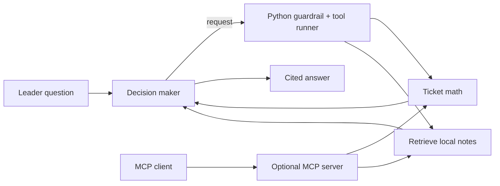

# Build an agent from scratch: your practical field guide

This guide is designed to answer two questions together: **“What is this concept?”** and **“Where is it in the code I can run?”** Read it beside the [video](https://www.youtube.com/watch?v=H5o1P8RMiMw), but you should not need to reopen the video to recall the architecture. Its chapter links are learning anchors, not claims that this repository reproduces the creator's code.

## The business story

Your fictional support team had six tickets in each of two weeks. A leader asks, *“Why did support SLA fall this week, and what should we investigate?”* The assistant may read sample ticket records and local notes. It may **not** change a ticket or send a message. A convincing answer has three layers:

1. **Measured fact:** prior SLA was 5/6 = 83.3%; current SLA was 3/6 = 50.0%; change = −33.3 percentage points.
2. **Contribution:** West added two late tickets, the largest regional increase.
3. **Possible explanation:** note `K-02` mentions routing and staffing changes. That is a lead to check, not proof of causality.

Run `python3 -m agent_lab.cli --trace` and follow the three tool calls printed on screen.

## One-page map



**Vocabulary:** A *model* proposes what to do. A *harness* is the surrounding Python that accepts or rejects requests, runs tools, stores state, and stops the loop. A *tool* is an approved function. *RAG* retrieves source material so the model can use it. *MCP* standardizes how another client can discover and call tools. *Evaluation* checks whether the system actually works.

## 1. Environment and the first call

**Video:** [setup 0:45](https://www.youtube.com/watch?v=H5o1P8RMiMw&t=45s), [calling an LLM 5:50](https://www.youtube.com/watch?v=H5o1P8RMiMw&t=350s)

Start with `python3 -m agent_lab.cli`. It runs for free because [`PracticeModel`](agent_lab/model.py) returns predictable `Decision` objects. A decision is either a tool request or a final answer:

```python
@dataclass
class Decision:
    tool: Optional[str] = None
    arguments: Optional[dict] = None
    answer: Optional[str] = None
```

**Why this matters:** the rest of the harness works the same regardless of who makes the decision. To see real model decisions, install the optional `live` dependency and run `--mode live`. [`OpenAIModel.decide()`](agent_lab/model.py) sends the question and tool definitions to the Responses API. The model can return a `function_call`; Python is still responsible for executing it. [Official function-calling flow](https://developers.openai.com/api/docs/guides/function-calling).

**Interview version:** “I separated the model decision from tool execution. I can swap a deterministic practice model for a live one without changing the tool boundary.”

## 2. Tool calling: a request is not an action

**Video:** [tool calling 14:44](https://www.youtube.com/watch?v=H5o1P8RMiMw&t=884s)

Read [`SCHEMAS` and `execute()`](agent_lab/tools.py). The schema tells a live model which functions exist and which arguments are allowed. `execute()` is the *actual* allowlist:

```python
if name == "find_driver" and set(args) == {"dimension"}:
    return find_driver(args["dimension"])
raise ValueError("unapproved tool or arguments")
```

If a model asks for `delete_tickets`, the program raises an error. It does not look up and execute an arbitrary function by name. In `find_driver()`, Python validates that `dimension` is `region` or `category` and then calculates a result from the sample ticket file. **The LLM should never be the source of the arithmetic.**

**Try it:** Run `python3 -c "from agent_lab.tools import execute; execute('delete_tickets', {})"` and see the guardrail reject the call. Then try `find_driver('category')` in a Python shell. The result is a *different breakdown* of the same data, not a newly invented cause.

**Interview version:** “Tool calling gives a model controlled access to functions. The application validates arguments and executes the function; the model only proposes the call.”

## 3. The agentic loop

**Video:** [agentic loop 22:56](https://www.youtube.com/watch?v=H5o1P8RMiMw&t=1376s)

Open [`run()`](agent_lab/harness.py). It is deliberately short:

```python
for step in range(max_steps):
    decision = model.decide(question, history)
    if decision.answer is not None:
        return {"answer": decision.answer.strip(), "trace": history}
    result = execute(decision.tool, decision.arguments)
    history.append({"name": decision.tool, "result": result, ...})
```

The ellipsis above omits `arguments` and `call_id`; see the actual file for those fields. The **trace** is what the agent did during one run; it is different from long-term memory. `max_steps` prevents endless tool calling. In practice mode, the sequence is `compare_sla` → `find_driver` → `retrieve_notes` → final answer. In live mode the model chooses; output can vary.

**Try it:** Set `max_steps=2` in a Python call to `run(...)`. It stops before the scripted model can answer. The [test](tests/test_lab.py) checks this behavior.

**Interview version:** “An agent loop is repeated model decision, bounded tool execution, and evidence returned to the model until it finishes or reaches a stop rule.”

## 4. MCP: a common interface to the tools

**Video:** [MCP servers 25:36](https://www.youtube.com/watch?v=H5o1P8RMiMw&t=1536s)

[`mcp_server.py`](agent_lab/mcp_server.py) wraps `compare_sla`, `find_driver`, and `retrieve_notes` with FastMCP. An external compatible client can discover and call those tools over stdio. The same functions power the CLI, but **the CLI does not call through MCP**. The server is a separate adapter.

```python
server = FastMCP("Agent Harness Lab")
server.tool()(compare_sla)
server.tool()(find_driver)
server.tool()(retrieve_notes)
server.run()
```

**Why this matters:** MCP solves interoperability between a client and tools. It does not, by itself, give an LLM judgment, memory, or good analytics. If asked whether this demo has “an MCP agent,” say accurately: “It has an MCP tool server and an independent agent loop over the same functions.”

### API versus MCP: watch the complete round trip

The [KodeKloud MCP vs API explanation](https://www.youtube.com/watch?v=kn6dxL53NkM) makes the client/server roles especially clear. The most useful improvement to this lab is now runnable: `python -m agent_lab.compare_interfaces` (Python 3.10+ and `pip install -e '.[mcp]'`).

```text
DIRECT API
Python client → HTTP POST /tools/compare_sla → tiny API server → compare_sla()
       ← JSON result                             ← same calculation

MCP
Python host → MCP client → list_tools() → MCP server → tool definitions
            → call_tool("compare_sla") → MCP server → compare_sla()
            ← tool result                                      ← same calculation
```

Read [`compare_interfaces.py`](agent_lab/compare_interfaces.py) alongside [`http_api.py`](agent_lab/http_api.py) and [`mcp_server.py`](agent_lab/mcp_server.py). In the direct path, the client knows the endpoint and JSON request format ahead of time. In the MCP path, it first asks the server what tools exist, then calls one by name. **Both return the same SLA calculation.** In a real integration, the server might wrap an existing company's API; MCP would standardize the connection to AI clients, while the underlying API still performs its normal work. Our sample server wraps a local Python function instead, so it needs no company credentials.

| Role | In this lab | What it owns |
|---|---|---|
| Host/application | `compare_interfaces.py` | Starts the comparison and decides which call to make |
| Direct API client | `call_direct_api()` | Knows the URL, sends HTTP, parses JSON |
| API server | `ToolAPIHandler` | Receives the HTTP request and invokes approved logic |
| MCP client | `ClientSession` in `call_mcp()` | Initializes the connection, discovers tools, sends a tool call |
| MCP server | `FastMCP` in `mcp_server.py` | Advertises approved tools and routes the call |
| Underlying function | `compare_sla()` | Calculates the result from ticket records |
| Model | **Not used in this comparison** | The separate live-agent mode can propose tool calls; no model directly executes them |

**Decision rule:** For one app and a few known operations, a direct API can be simpler. MCP pays off when multiple AI clients need a reusable, discoverable interface to the same capability. Either way, the executing software—not the model—must hold credentials, enforce permissions, and handle failures. MCP discovery can also consume context if too many tools are passed to a model, so expose the small set relevant to the task. The video's integration-count example is a teaching simplification, not a guaranteed engineering cost saving.

**Try it:** Change the direct API path in `call_direct_api()` and observe the request fail; then run the unchanged MCP path. Add a new read-only tool to `mcp_server.py` and see it appear in the discovered list. Explain why neither change modifies `compare_sla()`.

**Interview version:** “An API defines operations a service exposes. An MCP server can wrap those operations and advertise tools through a standard protocol. The host's MCP client discovers and calls them; the server or underlying API performs the work. The model only proposes an action when a model is present.”

## 5. Memory: what persists between requests

**Video:** [saving memory 30:53](https://www.youtube.com/watch?v=H5o1P8RMiMw&t=1853s)

[`memory.py`](agent_lab/memory.py) writes a small JSON list of prior questions and answers only when you pass `--remember`. The file is ignored by Git. `--show-memory` lets you inspect it. This is **stored Q&A history**, not a semantic memory system or automatic context injection. It helps you see the persistence mechanism before adding retrieval of prior sessions.

**Try it:** `python3 -m agent_lab.cli --remember`, then `python3 -m agent_lab.cli --show-memory`. The agent's next answer remains unchanged because we did not secretly feed that memory back into its model prompt. A useful next experiment is to decide *when* prior answers should be relevant, then add a small memory-selection function and test it.

## 6. RAG: retrieve evidence before writing

**Extension beyond the video:** [RAG explanation in your broader guide](https://github.com/kasteway/applied-ai-learning-lab/blob/main/STUDY_GUIDE.md#6-retrieval-augmented-generation-rag)

[`retrieve_notes()`](agent_lab/tools.py) tokenizes the question and each local note, counts overlapping words, and returns the highest matches with `K-01`–`K-04` source IDs. The live model can use those passages to ground an answer. This is an intentionally simple **lexical RAG baseline**; it does not use embeddings. It is excellent for learning because you can inspect why a note matched.

```python
score = len(terms & _tokens(note["title"] + " " + note["text"]))
```

**Try it:** Compare `retrieve_notes('West delivery routing staffing')` with `retrieve_notes('SLA definition')`. Then edit a note in `data/knowledge.json` and see how the result changes. A production extension might use embeddings, but first establish whether it improves retrieval on test questions.

**Interview version:** “RAG brings relevant documents into the response at runtime. I preserved source IDs so the answer can point to evidence, and I can evaluate retrieval separately from generation.”

## 7. Evaluation: prove more than a nice demo

**Extension beyond the video:** [`evaluate.py`](agent_lab/evaluate.py) checks six explicit properties: arithmetic, driver ranking, retrieval, tool sequence, citation, and cautious language. Run `python3 -m agent_lab.evaluate`. [`tests/test_lab.py`](tests/test_lab.py) also checks invalid tools, invalid dimensions, loop bounds, and local memory.

These checks make the **practice mode** reproducible. They do **not** prove that a live model always behaves correctly. For live mode, build a larger question set, run multiple times, and inspect tool choice, answer accuracy, citation support, latency, and cost. If you change the prompt or model, compare against the same baseline cases.

**Interview version:** “I test each layer separately: math and tool guards with deterministic tests, retrieval with known queries, and live-model behavior with representative evaluation cases.”

## 8. Safeguards and trust boundaries

**Extension beyond the video:** The agent is read-only. `execute()` accepts only three named tools. The data files are local and fictional. Inputs are length-limited; dimensions and retrieval limits are validated. The loop has a maximum number of steps. There is no browser, email, shell, or arbitrary code tool. The answer separates a measured change from an unproven operational explanation.

**Critical distinction:** a model's natural-language instruction to “only use approved tools” is helpful, but the security boundary is the Python allowlist and argument validation. A more serious deployment also needs user authentication, row-level data permissions, audit logs, and policy checks before any write action.

## 9. A short interview walkthrough

“I built a small agent harness in Python to understand what agent frameworks automate. The business case is support SLA diagnosis. A model proposes a tool call; Python validates it and runs deterministic analytics or retrieves local evidence. The loop repeats until an answer is ready or reaches a step limit. I exposed the same approved functions through an MCP server for interoperability. I added source citations, a small evaluation suite, and read-only guardrails. The offline mode is scripted for repeatable study; the optional live mode uses actual model-chosen calls. I would evaluate live runs before treating the answer as reliable in production.”

## Your next experiments

1. **Change the data:** make East the largest contributor, update the expected checks, and explain how the answer should change.
2. **Add a tool:** implement `find_driver('category')` as a separate named tool and update the schema, dispatcher, practice model, and tests. This teaches the full tool contract.
3. **Compare retrieval methods:** write five questions with expected note IDs. Test lexical matching, then add embeddings only if you can measure an improvement.
4. **Build a live eval:** run a small set of questions repeatedly with `--mode live`. Record answer accuracy, tool choice, citations, latency, and cost. Avoid claiming general reliability from one run.
5. **Compare API and MCP:** run `python -m agent_lab.compare_interfaces`, trace both round trips, and explain why the CLI still works without MCP.

For the broader concepts—models, embeddings, prompt engineering, and production design—keep using [your Applied AI Field Guide](https://github.com/kasteway/applied-ai-learning-lab/blob/main/STUDY_GUIDE.md). This repo is the runnable companion for **how agents are built**.
